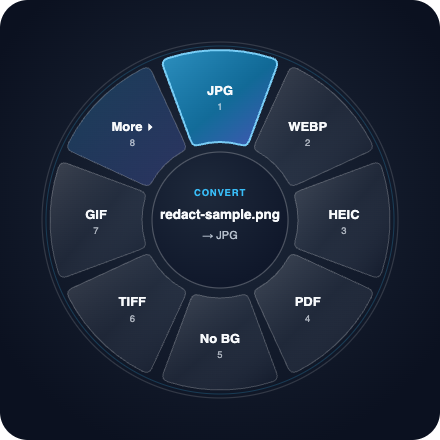
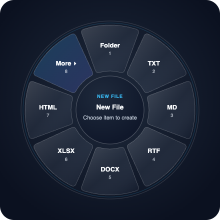
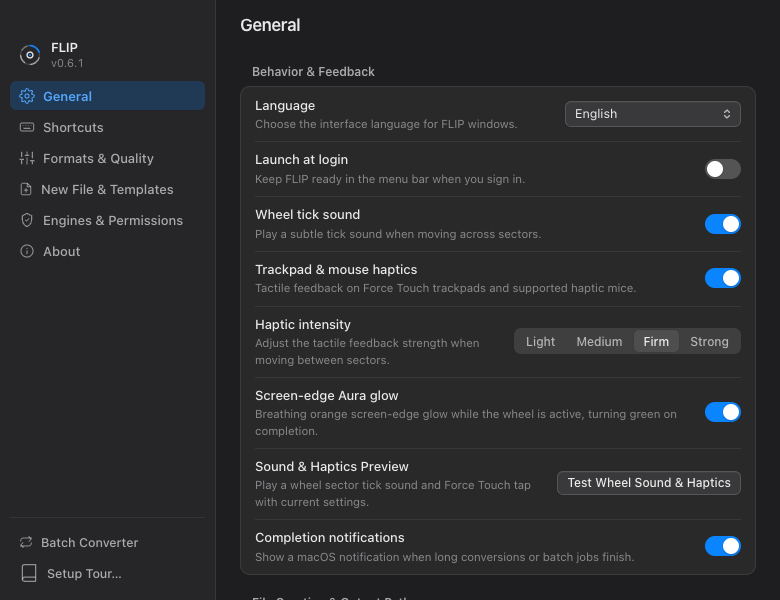

# FLIP per macOS

FLIP per macOS è un porting indipendente e comunitario di FLIP per Apple Silicon. Usa motori locali macOS e strumenti opzionali per convertire i file senza inviarli a servizi cloud.

> Questo è un porting comunitario per macOS, **non una release ufficiale del team tinyfoundry**. Non è certificato o notarizzato da Apple.

**[Scarica la release macOS](https://github.com/mehdizabo/FLIP-macOS/releases/latest)** · [English](README.md) · [Changelog](CHANGELOG.md)

## Disponibilità

- Apple Silicon (`arm64`)
- macOS 15 Sequoia o successivi
- Build ad-hoc, senza Apple Developer ID
- Nessun build Intel al momento

## Schermate

| Ruota Converti | Ruota Nuovo File |
|---|---|
|  |  |

| Impostazioni generali | Convertitore batch |
|---|---|
|  |  |

---

## Funzionalità principali

La DMG non è notarizzata da Apple: al primo avvio macOS potrebbe mostrare un avviso di Gatekeeper.

## Installazione

1. Scarica `FLIP-*-macOS-arm64.dmg` dalle Release.
2. Apri la DMG e trascina `FLIP.app` nella cartella Applicazioni.
3. Usa il clic destro su `FLIP.app` e seleziona **Apri**.
4. Conferma l'avviso al primo avvio, solo se scegli consapevolmente di eseguire l'app.

Gli utenti che comprendono il rischio possono rimuovere il quarantine da Terminale:

```sh
xattr -dr com.apple.quarantine /Applications/FLIP.app
```

## Funzioni

- Ruota radiale nativa per le conversioni
- Conversioni locali di immagini, PDF, audio, video e dati strutturati
- Selezione file orientata a Finder
- Interfaccia macOS con controlli di accessibilità
- Integrazione facoltativa con FFmpeg, Pandoc, Whisper e Ghostscript
- OCR e strumenti immagine locali
- Impostazioni, conversione batch e controlli aggiornamento

Le autorizzazioni di Accessibilità e Monitoraggio ingresso sono facoltative e possono essere negate senza disabilitare le conversioni principali.

## Privacy e sicurezza

Le conversioni sono progettate per restare locali e non richiedono account cloud. Questa build non dispone di notarizzazione Apple: l'avviso Gatekeeper va valutato dall'utente.

Una firma ad-hoc può cambiare dopo una sostituzione o ricostruzione dell'app, richiedendo eventualmente di riconfermare i permessi macOS.

Verifica lo SHA-256 pubblicato con ogni asset e non condividere log o documenti privati.

## Rapporto con il progetto originale

La release macOS deriva da concetti e codice MIT del progetto [thetinyfoundry/FLIP](https://github.com/thetinyfoundry/FLIP), ma viene mantenuta indipendentemente. Non è ufficiale, integrata o approvata dal progetto Windows.

Il codice, gli avvisi delle dipendenze e le licenze third-party sono conservati nel repository secondo i termini della licenza MIT.
