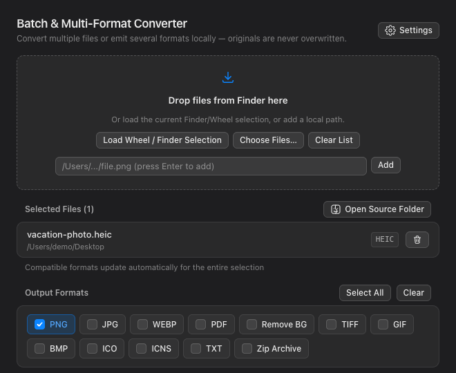

# FLIP per macOS

**Convertitore radiale di file e utility Create New File in stile Liquid Glass, 100% locale per macOS Finder.**

[English (README.md)](README.md)

FLIP porta una ruota radiale veloce centrata sul cursore (ispirata all'Actions Ring di Logi Options+) direttamente su Finder e Scrivania di macOS. Converte immagini, PDF, documenti, dati strutturati, audio, video e file Apple iWork **senza mai sovrascrivere gli originali né caricare nulla nel cloud** — e crea nuovi file o template personalizzati direttamente nella cartella attiva del Finder con rinomina inline immediata.

---

## Schermate

| Ruota Converti | Ruota Nuovo File |
|---|---|
|  |  |

| Impostazioni generali | Convertitore batch |
|---|---|
|  |  |

---

## Funzionalità principali

- **Ruota Radiale Liquid Glass**: settori in vetro traslucido stratificato, riflessi speculari direzionali, animazioni a molla, anteprima QuickLook nell'hub centrale, selettore modalità `Convert` / `New File` (`Tab`), arco radiale di avanzamento con percentuale, **annunci VoiceOver live**, **selettore lingua English / Italiano (`EN` / `IT`)**, feedback acustico (`flip-tick.wav`), aptico sul trackpad e pulsante **Prova suono e feedback aptico ruota**.
- **Strumenti immagine (seconda faccia della ruota, `T`)**: per qualsiasi selezione di immagini la ruota offre anche **Ritaglia** (`9:16` Reel, `4:5`, `1:1`, `16:9`), **Ruota / Specchia**, **Scala** (50 %, 25 %, 1080p, 720p, sotto 1 MB), **palette di colori**, **Oscura** (l'OCR trova IBAN, numeri di carta, email, numeri di telefono e codici fiscali e li copre con riquadri neri opachi, rimuovendo gli EXIF; l'etichetta ricorda sempre di controllare il risultato) ed **eliminazione di EXIF / posizione** — ogni strumento scrive un nuovo file accanto all'originale (`foto-crop-9x16.jpg`), mantiene il formato di partenza e non sovrascrive mai nulla. Disponibile anche da CLI: `flip convert foto.jpg --to CROP_9_16,SCALE_1080P` (`flip --help` elenca tutti gli strumenti).
- **App Menu Bar (`LSUIElement`) & IPC Single-Instance**: vive nella barra dei menu senza ingombrare il Dock (`Open FLIP Wheel`, `New File in Finder Folder…`, `Batch / Multiple Formats…`, `Settings & Shortcuts…`, `Open Templates Folder`, `Reveal Diagnostic Logs`, `Quit FLIP`). Garantisce istanza singola tramite `flock` e Unix domain socket locale (`flip-instance.sock`, permessi `0600`) per gestire Azioni Rapide, URL `flip://` e comandi di controllo CLI.
- **Convertitore Batch & Multi-Formato**: converte più file verso uno o più formati contemporaneamente (`Shift+Click` su un settore, pulsante `Multi` al centro o dal menu nella menu bar).
- **Naming senza sovrascrittura**:
  - **Conversioni**: ereditano direttamente il nome base del file originale (`photo.heic` → `photo.png`). In caso di collisione aggiunge il contatore stile Finder (`photo 2.png`, `photo 3.png`). Le esportazioni multipagina usano `<nome>-p001.<ext>`. Non attiva **mai** la rinomina inline sulle conversioni.
  - **Staging atomico e protezioni**: ogni job lavora in `.flip-job-<uuid>`, valida gli output prima del commit atomico (`renamex_np(RENAME_EXCL)`), rifiuta symlink, alias del Finder, file iCloud non scaricati localmente e volumi di rete, limita i batch a 128 file, blocca immagini > 40 MP, ottimizzazioni PDF oltre 200 pagine e archivi ZIP > 256 MiB / 4.096 entry / Zip-Slip, e sanitizza HTML e SVG offline.

---

## Trigger disponibili

| Modalità | Trigger predefinito | Funzionamento |
|---|---|---|
| **Drag + Tastiera** | `Freccia Giù` (configurabile) | Trascina uno o più file dal Finder/Scrivania e premi `Down` (oppure tieni premuto `Down` prima di trascinare). Rilascia su un settore compatibile. Legge `NSPasteboard(name: .drag)` in tempo reale prima del drop. |
| **Idle + Tastiera** | `Option+Shift+Space` (configurabile) | Apre la ruota sotto il cursore ovunque. Se ci sono file selezionati nel Finder si apre in modalità **Convert**; altrimenti in **New File** sulla cartella attiva del Finder (fallback `~/Desktop`). Premi `Tab` per cambiare modalità. |
| **Tasto Mouse (Opzionale)** | Disabilitato (opzionale `Btn 2` / `3` / `4`) | Supporto tieni-premuto-e-rilascia per tasto centrale o laterali (mouse Logi / multi-tasto). |

La ruota supporta anche frecce direzionali, tasti numerici `1`–`8`, `Invio`/`Spazio`, `Tab`, `Esc` (annulla o chiude) e dwell di 300 ms su `More ▸` / `Back ◂` durante il trascinamento quando ci sono più di 7 formati.

---

## Create New File

FLIP aggiunge la creazione immediata di nuovi file nella cartella del Finder in primo piano (con fallback su `~/Desktop` o cartella personalizzata nelle Impostazioni), seleziona il file nel Finder e **avvia subito la rinomina inline (`Invio`)**:

- **Tipi predefiniti**: Cartella (`untitled folder`), Plain Text (`.txt`), Markdown (`.md`), Rich Text (`.rtf`), Word (`.docx`), Foglio di calcolo (`.xlsx`), Presentazione (`.pptx`), PDF vuoto A4 (`.pdf`), HTML (`.html`), JSON (`.json`), CSV (`.csv`), Configurazione YAML (`.yaml`), Configurazione TOML (`.toml`), Documento XML (`.xml`), Shell Script eseguibile (`.sh`, `chmod +x`), Python (`.py`), Swift (`.swift`).
- **From Clipboard**: ispeziona `NSPasteboard.general` e salva immagini (`.png`), PDF, RTF, segnalibri web (`.webloc`) o testo (`.txt`) come `Clipboard <timestamp>.<ext>`.
- **Apple iWork**: crea nuovi `.pages`, `.numbers` e `.key` se Pages, Numbers o Keynote sono installati.
- **Template utente**: inserisci qualsiasi file in `~/Library/Application Support/FLIP/Templates` (le sottocartelle diventano gruppi). I template testuali espandono automaticamente `{{date}}`, `{{time}}`, `{{user}}` e `{{folder}}`.

---

## Conversioni supportate e integrazione Apple

| Famiglia | Input | Output | Motori |
|---|---|---|---|
| **Immagini** | `PNG`, `JPG/JPEG`, `WEBP`, `HEIC/HEIF`, `AVIF`, `TIFF`, `GIF`, `BMP`, `ICNS`, `ICO`, `SVG` (sanitizzato offline) | `PNG`, `JPG`, `WEBP`, `HEIC`, `PDF`, `TIFF`, `GIF`, `BMP`, `ICO`, `ICNS`, `TXT` (OCR), `REMOVE_BG`, `ZIP`, più `COMBINE_PDF` e `ANIMATE_GIF` (`GIF+`) | `ImageIO` nativo (EXIF & rimozione GPS opzionale) + `Vision` (`VNGenerateForegroundInstanceMaskRequest` `REMOVE_BG`) + `image` Rust + `PDFKit` |
| **PDF** | `PDF` | `PNG`, `JPG`, `WEBP`, `HEIC`, `TIFF` (144/200/300 DPI), `TXT` (con **Apple Vision** OCR per PDF scansionati), `DOCX`, `MD`, `HTML`, `RTF`, `ODT`, `EPUB` (EPUB 3 nativo), `FB2`, `RST` (nativi zero-Pandoc o Pandoc), `OPTIMIZE_PDF` (compressione PDF preservando testo selezionabile), `PDFA` (PDF/A-2b, richiede Ghostscript opzionale), `ZIP`, `Merge PDFs` | `PDFKit` / Quartz nativo + `Vision` (`VNRecognizeTextRequest`) + writer EPUB 3 / FB2 / RST in Rust + `Ghostscript` opzionale (`PDFA`) |
| **Documenti** | `TXT`, `MD`, `HTML`, `RTF`, `DOC`, `DOCX`, `ODT`, `EPUB`, `FB2`, `RST` | `PDF` (A4/Letter impaginato), `DOCX`, `MD`, `HTML`, `TXT`, `RTF`, `ODT`, `EPUB` (EPUB 3 nativo), `FB2`, `RST` (nativi zero-Pandoc o Pandoc), `PNG`, `JPG`, `WEBP`, `HEIC`, `ZIP` | `NSAttributedString` / CoreText nativo + `pulldown-cmark` + EPUB 3 / FB2 / RST nativi + `Pandoc` opzionale |
| **Apple iWork** | `.pages`, `.numbers`, `.key` | `PDF`, `ZIP` (+ `DOCX`/`RTF`/`TXT`/`EPUB` per Pages, `XLSX`/`CSV` per Numbers, `PPTX` per Keynote) | Anteprima QuickLook + AppleScript verso app Apple |
| **Dati strutturati** | `JSON`, `YAML/YML`, `TOML`, `XML`, `CSV`, `XLSX` | `JSON`, `YAML`, `TOML`, `XML`, `CSV` (appiattimento chiavi con punto), `XLSX` (OOXML nativo), `TXT`, `MD`, `HTML`, `PDF`, `ZIP` | Parser Rust nativi + reader/writer `XLSX` puro Rust + CoreText PDF |
| **Audio** | `MP3`, `WAV`, `M4A`, `AAC`, `AIFF`, `ALAC`, `CAF`, `FLAC`, `OGG`, `OPUS`, `WMA` | **Nativi (zero FFmpeg)**: `M4A`, `WAV`, `FLAC`, `AIFF`, `ALAC`, `CAF` · Con FFmpeg: + `MP3`, `OGG`, `OPUS`, `AAC`, più `ZIP` · `TRANSCRIBE` (`.txt`, richiede i tool Whisper opzionali) | `AVFoundation` nativo + CoreAudio `ExtAudioFile` + `/usr/bin/afconvert` + `FFmpeg` opzionale |
| **Video** | `MP4`, `MOV`, `M4V`, `MKV`, `WEBM`, `AVI`, `WMV` | Nativi: `MP4`, `MOV`, `M4V`, `M4A`, `WAV`, `GIF` animata, `ZIP` · Con FFmpeg: + `MKV`, `WEBM`, `AVI`, `MP3` · `TRANSCRIBE` (`.txt`, richiede FFmpeg e i tool Whisper opzionali) | `AVFoundation` nativo + `FFmpeg` opzionale (progresso in tempo reale & `Esc`) |
| **Archivi** | `ZIP` (e qualsiasi selezione di file) | `UNZIP` (estrazione sicura in sottocartella) · `ZIP` (creazione archivio senza sovrascritture) | Motore Rust `zip` (`archive.rs` con blocchi Zip-Slip e >256 MiB / 4.096 entry) |

> **Nota sui tool opzionali**: FFmpeg e Pandoc **non** sono inclusi nel bundle. **EPUB 3, `FB2`, `RST` e le conversioni audio lossless `CAF` e `FLAC` funzionano nativamente senza FFmpeg e senza Pandoc.** Installa `brew install ffmpeg pandoc` (o indica i percorsi in **Settings → Engines & Permissions**) per sbloccare formati extra (`MKV`/`WebM`/`AVI`/`MP3`/`OGG`/`OPUS`/`AAC` con FFmpeg) o preferire Pandoc quando installato. Imposta `FLIP_DISABLE_FFMPEG=1` o `FLIP_DISABLE_PANDOC=1` per forzare i soli motori nativi integrati.
>
> Anche **Transcribe (`TRANSCRIBE`)** è opzionale: `whisper.cpp` e il modello vocale **non** sono inclusi nel bundle. Installali con `./scripts/install-whisper.sh` (prima stampa i comandi che eseguirebbe e agisce solo con `--yes`), oppure a mano con `brew install whisper-cpp` più `ggml-small.bin` in `~/Library/Application Support/FLIP/models/`. La trascrizione avviene interamente sul tuo Mac; imposta `FLIP_DISABLE_WHISPER=1` per nascondere la bolla Transcribe.
>
> Anche **PDF/A (`PDFA`)** è opzionale e richiede **Ghostscript**, che **non** è incluso: è software libero con licenza AGPL e lo installi tu, con `./scripts/install-ghostscript.sh` (prima stampa cosa farebbe e agisce solo con `--yes`) oppure a mano con `brew install ghostscript`. FLIP trasforma un PDF in un file **PDF/A-2b** con lo stesso schema di nome degli altri risultati PDF (`nome 2.pdf`); l'originale non viene mai toccato. Cosa promette: il risultato è dichiarato PDF/A-2b e controllato dall'ispezione interna di FLIP, e in una prova del 21/11/2026 veraPDF lo ha validato su 16 file reali su 16. **Non è una certificazione.** Link, segnalibri e titoli restano. Cosa costa: i colori vengono convertiti in RGB (un PDF da stampa perde il CMYK), le impostazioni di sovrastampa (overprint) vengono eliminate e le immagini con `/Interpolate true` vengono modificate. I PDF protetti da password vengono rifiutati. **Se FLIP non riesce a mantenere il testo selezionabile non scrive nulla e lo dice** (è successo con 2 file su 16). Imposta `FLIP_DISABLE_GHOSTSCRIPT=1` per nascondere la bolla PDF/A.

---

## CLI e comandi di controllo

FLIP include una CLI integrata in `FLIP.app/Contents/MacOS/flip` (collegabile in `~/.local/bin/flip` da **Settings → Engines & Permissions**):

```bash
flip                                          # Avvia app menu bar (istanza singola)
flip convert <file...> --to <FMT[,FMT2]>      # Conversione locale con output JSON
flip new <kind> [--in <folder>] [--no-rename] # Crea nuovo file/cartella
flip wheel [--mode convert|new] [files...]    # Apre la ruota via Unix socket IPC
flip settings                                 # Apre la finestra Impostazioni
flip batch [files...]                         # Apre il convertitore Batch & Multi-Formato
flip preview --out <path.svg> [--files f1,f2] [--mode convert|new] [--hover N]
                                              # Genera anteprima SVG standalone della ruota
flip quit                                     # Chiude in modo pulito l'istanza attiva
flip --help                                   # Guida rapida CLI
flip --version                                # Mostra versione
```

---

## Permessi macOS

- **Accessibilità** (`Impostazioni di Sistema → Privacy e sicurezza → Accessibilità`): permette al `CGEventTap` di intercettare il tasto di drag *solo* durante un trascinamento file (senza disturbare la digitazione normale) e di inviare `Invio` per la rinomina inline nel Finder.
- **Automazione Finder** (`Privacy e sicurezza → Automazione → FLIP → Finder`): consente di leggere i file selezionati e la cartella attiva nel Finder.
- **Modalità limitata**: senza permessi FLIP resta utilizzabile tramite la scorciatoia Idle (`Option+Shift+Space`), il drag-and-drop diretto sulla ruota o sulla finestra Batch e il fallback su `~/Desktop`.

---

## Compilazione ed esecuzione locale

### Prerequisiti

- **macOS 15.0+** (Apple Silicon; sviluppato per **macOS 27.2.1 Golden Gate**)
- **Apple Command Line Tools** (`xcode-select --install`) — `Xcode.app` completo **non** è necessario (usa `/usr/bin/swiftc` e `/usr/bin/clang`)
- **Rust** (`cargo`) e `tauri-cli` (`cargo install tauri-cli --version ^2`)
- **Node.js e pnpm** (`corepack enable` oppure `brew install pnpm`; la versione è fissata in `package.json`), più **Bun** opzionale per i test frontend
- Opzionali: `brew install ffmpeg pandoc`

### Sviluppo

```bash
pnpm install
./native-bridge/build.sh
cargo tauri dev
```

### Packaging `.app`, `.dmg` e firma ad-hoc locale

Compila il bridge nativo Swift, il frontend Vite, il bundle `.app` release, verifica l'inclusione di `flip-macos-bridge` (`+x`) e `flip-tick.wav`, e applica la firma ad-hoc con verifica rigorosa in un solo comando (usa `--dmg` per generare anche l'immagine disco compressa e firmata):

```bash
./scripts/build-macos.sh --dmg
```

Output firmati:

```text
src-tauri/target/release/bundle/macos/FLIP.app
src-tauri/target/release/bundle/dmg/FLIP-0.6.1-macOS-arm64.dmg
```

Per installare o disinstallare localmente `FLIP.app` (copia in `/Applications` o `~/Applications`, rimozione `com.apple.quarantine`, installazione/rimozione Azioni Rapide e symlink `~/.local/bin/flip`), aggiornare lo SHA-256 della Homebrew Cask (`packaging/homebrew/flip.rb`), eseguire l'audit privacy o esportare i sorgenti:

```bash
# Installazione locale completa (app + Azioni Rapide + CLI ~/.local/bin/flip)
./scripts/install-local.sh

# Disinstallazione pulita (app + Azioni Rapide + symlink ~/.local/bin/flip)
./scripts/install-local.sh --uninstall

# Rigenera DMG e aggiorna SHA-256 in packaging/homebrew/flip.rb
./scripts/package-dmg.sh --update-cask

# Audit privacy del repository ed esportazione archivio sorgenti pulito
./scripts/audit-repository.sh
./scripts/export-source.sh

# Firma ad-hoc locale (nessun certificato a pagamento richiesto)
./scripts/sign-local.sh

# Opzionale: Developer ID + notarizzazione Apple
APPLE_SIGNING_IDENTITY="Developer ID Application: Il Tuo Nome (TEAMID)" \
APPLE_NOTARY_PROFILE="notary-profile" \
./scripts/sign-local.sh
```

### Suite di test

```bash
./native-bridge/build.sh
pnpm exec tsc --noEmit
pnpm run build
bun test
cd src-tauri && cargo clippy --all-targets -- -D warnings && cargo test
```

I risultati completi di test unitari, integrazione, stress a 50 cicli, benchmark di latenza e verifica `.app`/`.dmg` sono documentati in [`TEST_RESULTS.md`](TEST_RESULTS.md). Vedi anche [`ARCHITECTURE.md`](ARCHITECTURE.md), [`PUBLIC_RELEASE_REVIEW.md`](PUBLIC_RELEASE_REVIEW.md), [`ROADMAP.md`](ROADMAP.md) e gli script Raycast in `integrations/raycast/`.

---

## Problemi noti e limitazioni

1. **Firma ad-hoc**: `FLIP.app` e il `.dmg` usano una firma ad-hoc e non sono notarizzati da Apple (al primo avvio compare l'avviso di Gatekeeper; `./scripts/install-local.sh` rimuove la quarantena). Poiché il `cdhash` della firma ad-hoc cambia quando `FLIP.app` viene sostituito durante un aggiornamento, macOS azzera i permessi di Accessibilità e Monitoraggio Input: rimuovi la vecchia voce `FLIP` con `–` in Impostazioni di Sistema e aggiungila di nuovo.
2. **Solo Apple Silicon & macOS 15+**: compilato esclusivamente per `arm64` su macOS 15 Sequoia o successivo (nessuna build Intel `x86_64`).
3. **Serializzazione globale `CONVERSION_GATE`**: le conversioni concorrenti da ruota o batch restano in attesa mentre è in corso un job lungo `TRANSCRIBE` o `PDFA` (annullabile con `Esc`).
4. **Limiti PDF/A-2b**: validato con `veraPDF` (non è una certificazione ISO formale); converte i colori CMYK in sRGB, elimina le impostazioni di sovrastampa (overprint), altera le immagini con `/Interpolate true` e rifiuta i PDF protetti da password e quelli in cui il testo selezionabile non può essere preservato.
5. **Limiti Transcribe**: richiede `whisper-cli`, `ggml-small.bin` e `FFmpeg` esterni; l'audio silenzioso (`<= -50 dB`) viene rifiutato, ma rumore di fondo non parlato sopra `-50 dB` può causare allucinazioni di Whisper.
6. **Permessi parziali & Logitech HID++**: senza Accessibilità, `Option+Shift+Space` funziona tramite Carbon hotkey (`RegisterEventHotKey`), ma i tasti di drag e le scorciatoie della ruota non possono essere intercettati/soppressi e la rinomina inline del Finder (`Invio`) non scatta; il feedback aptico del mouse è rivolto ai Logitech MX Master (HID++) e richiede il permesso Monitoraggio Input.
7. **Limiti minori UI/overlay**: il bagliore ai bordi Aura viene renderizzato sul display attivo sotto il cursore; l'overlay della ruota `440×440` non è focalizzabile (le viste `Manual Crop` e anteprima `Space` vengono renderizzate al suo interno).

---

## Licenza

Licenza MIT — vedi [LICENSE](LICENSE).
