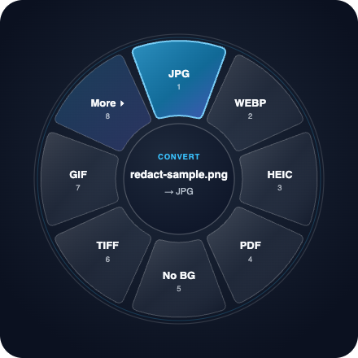
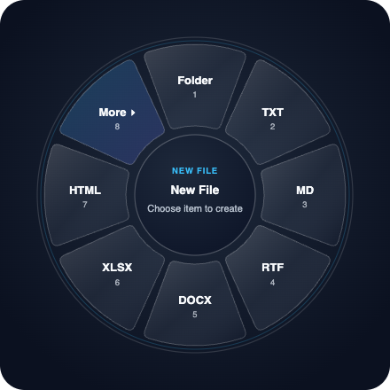
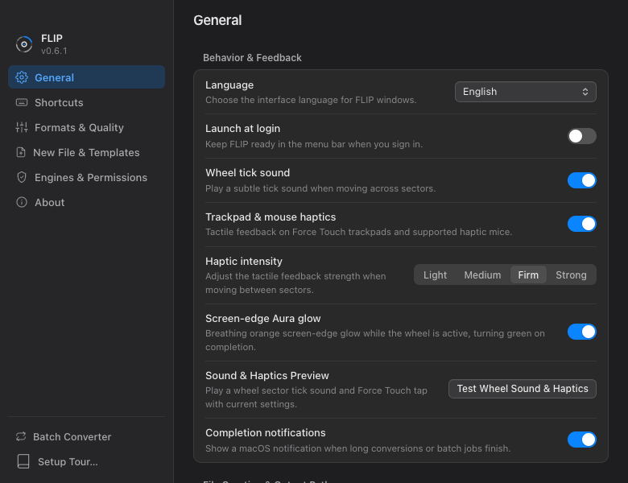
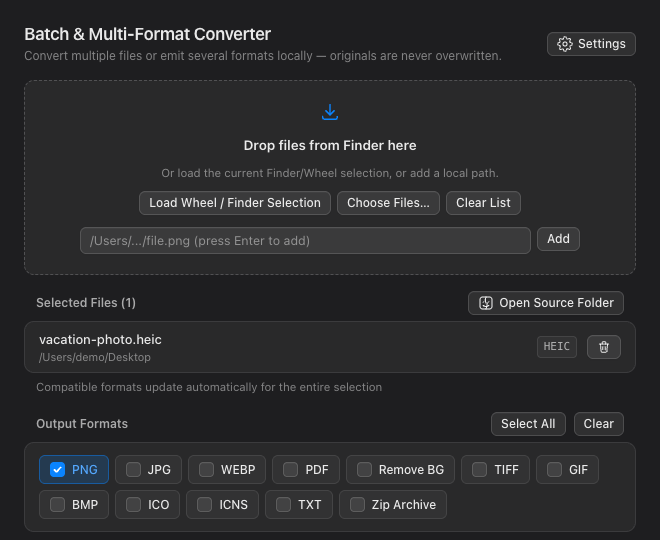

# FLIP for macOS

FLIP for macOS is an independent, native Apple Silicon port of FLIP. It uses local macOS engines and optional local tools to convert files without uploading them to a cloud service.

> This is a community macOS port, **not an official release by the tinyfoundry team**. It is not an Apple-certified or notarized application.

**[Download the current macOS release](https://github.com/mehdizabo/FLIP-macOS/releases/latest)** · [Italiano](README.it.md) · [Changelog](CHANGELOG.md)

## Availability

- Apple Silicon (`arm64`) only
- macOS 15 Sequoia or later
- Unsigned/ad-hoc-signed build
- Intel Macs are not currently supported

The DMG is not notarized with an Apple Developer ID. macOS can therefore show a Gatekeeper warning or quarantine the app.

## Installation

1. Download `FLIP-*-macOS-arm64.dmg` from Releases.
2. Open the DMG and drag `FLIP.app` into Applications.
3. Right-click `FLIP.app` in Applications and select **Open**.
4. Confirm the first-launch security prompt if you choose to run it.

For a terminal-based fallback, users who understand the risk can remove quarantine with:

```sh
xattr -dr com.apple.quarantine /Applications/FLIP.app
```

## Screens

| Convert wheel | New File wheel |
|---|---|
|  |  |

| General settings | Batch converter |
|---|---|
|  |  |

---

## Features

- Native macOS radial conversion wheel
- Local image, PDF, audio, video and structured-data conversion
- Finder-oriented file selection and drag workflows
- Apple Liquid Glass-style overlay and native accessibility controls
- Optional FFmpeg, Pandoc, Whisper and Ghostscript integration
- On-device OCR and image tools
- Settings, batch conversion and update controls

Optional engines are not bundled unless explicitly included in a release asset. Missing optional tools do not prevent conversions handled by macOS-native engines.

## Privacy

Conversion jobs are intended to run locally. No account or cloud conversion service is required. Read the release notes for each optional engine because third-party tools may have their own constraints.

## Security and trust

- No Apple Developer ID or Apple notarization is currently used.
- The app may require explicit first-launch approval.
- Accessibility and Input Monitoring permissions are optional features that can be denied without disabling the core app.
- Ad-hoc signatures can change after replacement or rebuilding, potentially resetting macOS privacy permissions.

Only install releases published in this repository and verify the SHA-256 checksum provided with each release.

## Relationship to the original project

The macOS edition is based on concepts and MIT-licensed code from [thetinyfoundry/FLIP](https://github.com/thetinyfoundry/FLIP). It is maintained independently and is not merged into or endorsed by the upstream Windows project.

Source code, bundled notices and third-party licenses are retained under the repository's MIT license terms. Upstream ownership and trademarks are not transferred.

## Contributing

Bug reports should specify the macOS version, Apple Silicon model, FLIP macOS version, input format and exact installation method. Do not upload personal files or private logs.
