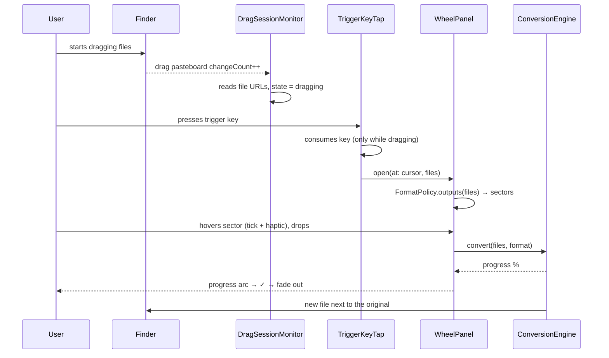
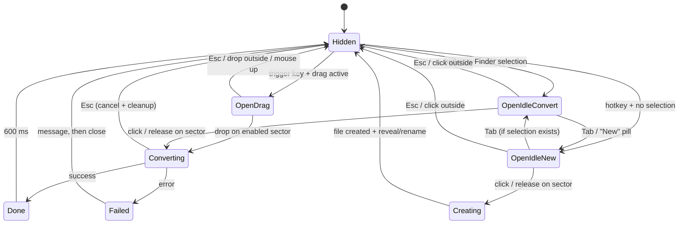

# 02 · Architettura

> **Documento storico di pianificazione.** Descrive il piano iniziale del porting (Swift/SwiftUI nativo) e non l'implementazione attuale. L'architettura vigente (Tauri v2 + Rust + bridge Swift) è in [`../ARCHITECTURE.md`](../ARCHITECTURE.md) e [`DECISIONS.md`](DECISIONS.md).

## Stack

- **Swift 6** (strict concurrency), **SwiftUI** per la UI e **AppKit** per pannelli, event tap, drag & drop e menu bar.
- **Xcode 26**, progetto con target multipli e moduli **Swift Package** locali, testabili senza UI.
- Dipendenze, minime:
  - `sindresorhus/KeyboardShortcuts` per il recorder e le hotkey globali
  - `sparkle-project/Sparkle` per gli aggiornamenti
  - `jpsim/Yams` per YAML
  - `apple/swift-markdown` per Markdown
  - `libwebp` per scrivere WebP
- Strumenti: SwiftLint, `swift-format`, XCTest/Swift Testing, `xcodebuild` + `notarytool` in CI (GitHub Actions su runner macOS).

## Moduli

```
FLIP.xcodeproj
├─ App/                     target "FLIP" (LSUIElement, menu bar)
│  ├─ AppDelegate, MenuBarController, SettingsScene, Onboarding
├─ Packages/
│  ├─ FlipCore/             puro Swift, nessuna UI: testabile
│  │  ├─ FormatPolicy       (porting di Policy.cs → UTType)
│  │  ├─ OutputNaming       ("name.converted.png", "name.converted 2.png")
│  │  ├─ JobStaging         (cartella .flip-job-UUID, commit senza overwrite, rollback)
│  │  ├─ Validation         (output non vuoto, riapribile, limiti dei contenitori zip)
│  │  └─ Preferences
│  ├─ FlipEngines/          convertitori, uno per famiglia
│  │  ├─ ImageEngine (ImageIO + libwebp)   ├─ PDFEngine (PDFKit)
│  │  ├─ DocumentEngine (NSAttributedString, swift-markdown, WebKit PDF)
│  │  ├─ DataEngine (JSON/XML/TabularData/Yams)
│  │  ├─ MediaEngine (AVFoundation)        ├─ ExternalTools (FFmpeg/Pandoc: Process)
│  │  └─ CreateNewEngine (generatori + template)
│  ├─ FlipInput/            trigger globali
│  │  ├─ DragSessionMonitor (NSPasteboard .drag + mouse monitor)
│  │  ├─ TriggerKeyTap      (CGEventTap con fallback Carbon)
│  │  ├─ FinderBridge       (selezione, insertion location, reveal/rename via Apple Events)
│  │  └─ PermissionCenter   (AXIsProcessTrusted, Automation, Input Monitoring)
│  └─ FlipWheel/            UI della ruota
│     ├─ WheelPanel (NSPanel) ├─ WheelView (SwiftUI) ├─ RingGeometry (geometria + hit test condivisi)
│     ├─ WheelViewModel       ├─ Feedback (suono + haptic)
├─ Extensions/
│  ├─ FlipFinderSync/       Finder Sync Extension (menu "New File ▸" / "Convert with FLIP ▸")
│  └─ FlipIntents/          App Intents (Shortcuts, Quick Actions, Spotlight)
└─ Tests/ (unit, golden-file, UI)
```

## Flusso principale



## Modello di stato della ruota



## Permessi

| Permesso | Perché | Obbligatorio? |
|---|---|---|
| Accessibility | `CGEventTap` attivo per consumare il tasto trigger solo durante il drag; rinomina inline nel Finder | Per la modalità completa (senza: modalità ridotta) |
| Automation → Finder | Leggere la selezione e la cartella frontale, rivelare e selezionare il file creato | Per la modalità Idle (fallback: Desktop) |
| Input Monitoring | Solo se scegliamo un tap *listen-only* al posto di Accessibility | Alternativa |
| Full Disk Access | **Non serve** | No |

`Info.plist` deve includere `NSAppleEventsUsageDescription` con un testo chiaro, in inglese.

## Distribuzione

- App **non sandboxed** (hardened runtime attivo), firmata **Developer ID Application**, **notarizzata** e con ticket allegato (*stapled*).
- Rilascio come `.dmg` firmato e appcast Sparkle su GitHub Releases. Homebrew Cask è opzionale.
- La Finder Sync Extension **deve** essere sandboxed: comunica con l'app tramite App Group e XPC.

## Principi portati da FLIP Windows (da non perdere)

1. L'originale non viene mai aperto in scrittura e mai sovrascritto.
2. Si lavora in staging (`.flip-job-UUID` accanto al sorgente) e si fa il commit senza overwrite. In caso di errore: rollback degli output di quel formato.
3. Validazione dell'output prima del commit.
4. Limiti: al massimo 128 file, niente percorsi di rete, alias o symlink, niente cartelle (per la conversione).
5. Processi esterni lanciati con argomenti strutturati, timeout e cancellazione.
6. Jobs serializzati, con un solo job attivo e la cancellazione con Esc.
